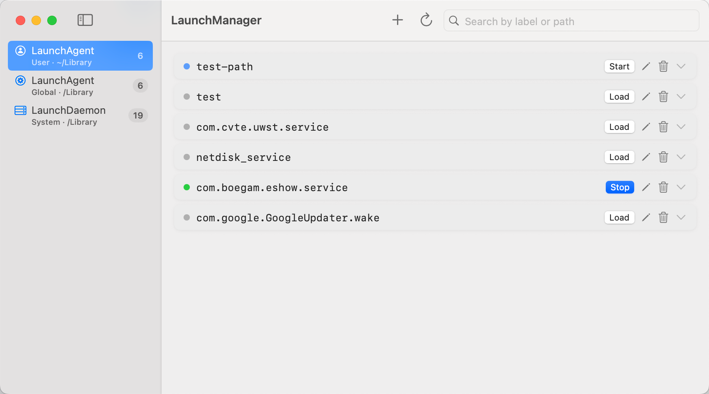

# LaunchManager

**English** | [中文](README.zh-CN.md)

**AI creates the jobs. You stay in control.**

A native macOS app for visually managing launchd tasks, background services, and the automation you build with AI.

AI assistants can write scripts, generate launchd `.plist` files, and help set up scheduled tasks in minutes. As those automations accumulate, you need a clear view of what they run, when they run, and how to manage them.

LaunchManager brings your LaunchAgents and LaunchDaemons into one native interface—so you can inspect what AI created, adjust its configuration, check logs, and decide what stays active.

- **Bring AI-generated jobs into view.** Import a `.plist` file or paste XML from your AI assistant.
- **Understand and edit your automation.** Browse jobs in one place and edit them with a form or XML editor.
- **Control what runs.** Load, unload, start, and stop jobs, with logs available when something goes wrong.
- **Keep automation running independently.** Tasks run through macOS launchd, even after you close LaunchManager.

Free and open source. Built with Swift and SwiftUI.

**Website:** [launchmanager.dev](https://www.launchmanager.dev) · **Docs:** [Help](https://www.launchmanager.dev/help) · **Templates:** [launchmanager.dev/templates](https://www.launchmanager.dev/templates)

   



## Features

### Core workflow

- **Import / Paste** — bring in a `.plist` or paste XML (including output from an AI assistant)
- **Browse & edit** — one list for User Agents, System Agents, and LaunchDaemons; edit with **Form** or **XML** (extra keys preserved)
- **Run control** — load, unload, start, and stop jobs; privilege escalation when system scope needs it
- **Logs** — file-based stdout/stderr and system log (`log show`) when something fails

### Also included

- Search across all scopes; clone a job with a new Label
- Multi-trigger editing: calendar, interval, and WatchPaths in one job
- Invalid plists shown inline with an option to delete
- **Services** — host TCP listeners and Docker ports published on your Mac; create a Launch Agent from a running service
- **Login Items guide** — how launchd differs from macOS Login Items
- Bilingual UI (English / Chinese); auto-update check via GitHub Releases
- Templates: [launchmanager.dev/templates](https://www.launchmanager.dev/templates)

## Requirements

- macOS 14 Sonoma or later
- Xcode 16 or later (to build from source)

## Installation

### Homebrew (recommended)

```bash
brew tap Sean10000/tap
brew install --cask launchmanager
```

### Direct Download

Download the latest **LaunchManager.dmg** from [Releases](https://github.com/Sean10000/LaunchManager/releases). Open the DMG and drag **LaunchManager** to the **Applications** folder shown in the window.

> **First launch:** right-click the app → Open (required because this build is not notarized by Apple).

### Build from Source

```bash
git clone https://github.com/Sean10000/LaunchManager.git
cd LaunchManager
open LaunchManager.xcodeproj
```

Build and run with Xcode (`⌘R`).

## Usage

1. Select **Launch Agents**, **Login Items**, or **Services** in the sidebar
2. **Import** a `.plist` or **Paste XML** (or create a new job from the **New** menu)
3. Edit with **Form** or **XML**; save and use row actions to **load / start / stop**
4. Expand a row for details and logs; clone from the row menu when needed
5. On **Services**, manage local listeners or create a Launch Agent from a running process

## Services

The **Services** sidebar scans **TCP ports listening on your Mac** (`lsof -iTCP -sTCP:LISTEN`). It is a local dev-environment view, not network-wide discovery.

### What it shows

- TCP services **listening on the host** (Next.js, Redis, PostgreSQL, etc.)
- **Docker / Colima** containers whose ports are **published on the Mac**

### What it does not show

- Outbound-only connections (`ESTABLISHED` where your Mac is the client)
- Services only listening inside a VM/NAS/other machine (unless forwarded to the Mac)
- UDP listeners

### Quick check

```bash
# Appears in Services only if the Mac is LISTENing on this port
lsof -iTCP:5666 -sTCP:LISTEN -nP

# Any socket involving port 5666 (including remote / outbound)
lsof -i :5666
```

## Project Structure

```
LaunchManager/
├── Models/          # LaunchItem, drafts, services, trigger rule types
├── Services/        # PlistService, TriggerCompiler, LaunchctlService, ProcessDiscovery, …
├── Store/           # AgentStore, ServiceStore, …
└── Views/           # SwiftUI (AgentList, ServicesList, EditAgentSheet, …)
```

## Star History

<a href="https://www.star-history.com/?repos=Sean10000%2FLaunchManager&type=date&legend=top-left">
 <picture>
   <source media="(prefers-color-scheme: dark)" srcset="https://api.star-history.com/chart?repos=Sean10000/LaunchManager&type=date&theme=dark&legend=top-left" />
   <source media="(prefers-color-scheme: light)" srcset="https://api.star-history.com/chart?repos=Sean10000/LaunchManager&type=date&legend=top-left" />
   
 </picture>
</a>

## License

MIT — see [LICENSE](LICENSE).

## Support

If LaunchManager saved you some time, feel free to buy me a coffee ☕ Americano is better.


