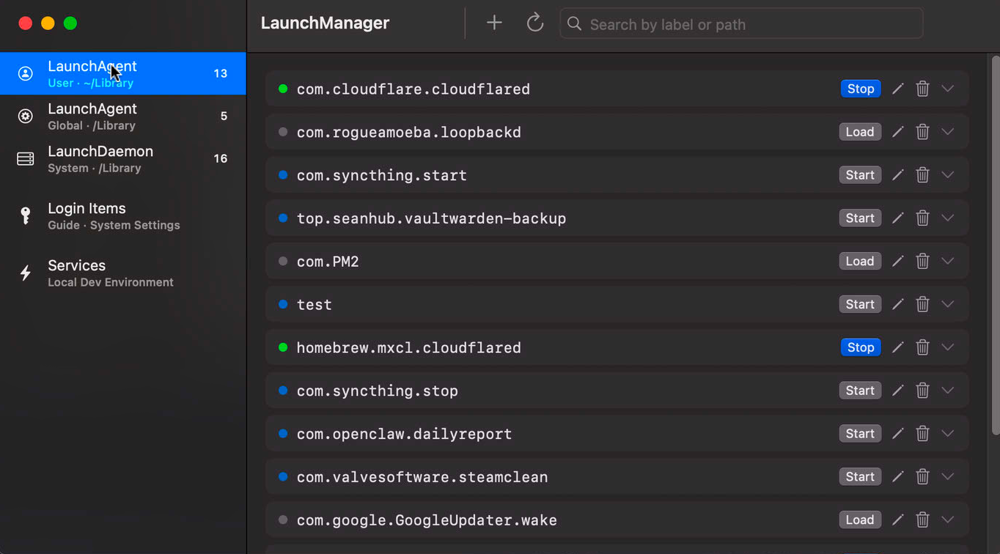

# LaunchManager

[English](README.md) | **中文**

**AI 创建任务，你掌握运行。**

LaunchManager 是一款原生 macOS 应用，让 AI 帮你创建的自动化任务，也能被清楚地查看和管理。

让 AI 写脚本、生成 launchd 配置、设置定时任务，只需要几句对话。随着自动化任务逐渐增多，你也需要知道：它们执行什么、何时运行、是否出错，以及如何停用。

LaunchManager 将分散的 LaunchAgents 和 LaunchDaemons 汇集到一个可视化界面。导入 AI 生成的 plist 或粘贴 XML，即可查看配置、调整任务、控制运行并检查日志。

从创建之后，到日常维护，让每个后台任务都看得见、管得住。

- **把 AI 生成的任务收进视野。** 导入 `.plist`，或粘贴助手给出的 XML。
- **看清并编辑自动化。** 在一个列表里浏览任务，用表单或 XML 编辑。
- **控制谁在跑。** 加载、卸载、启动、停止；出问题时可看日志。
- **关掉 App 也能继续跑。** 任务由 macOS launchd 执行，不依赖 LaunchManager 常开。

免费开源，使用 Swift 与 SwiftUI 构建。

**官网：** [launchmanager.dev](https://www.launchmanager.dev) · **帮助：** [Help](https://www.launchmanager.dev/help) · **模板：** [launchmanager.dev/templates](https://www.launchmanager.dev/templates)

   



## 功能

### 核心流程

- **导入 / 粘贴** — 导入 `.plist` 或粘贴 XML（含 AI 助手生成的内容）
- **浏览与编辑** — 统一查看用户 Agent、系统 Agent、LaunchDaemon；**表单** 或 **XML** 编辑（额外键会保留）
- **运行控制** — 加载、卸载、启动、停止；系统级操作可提权
- **日志** — 文件 stdout/stderr 与系统日志（`log show`）

### 其它

- 全范围搜索；克隆任务并指定新 Label
- 多触发编辑：日历、间隔、WatchPaths 可并存
- 无效 plist 行内展示并可删除
- **Services** — 本机 TCP 监听与已发布到 Mac 的 Docker 端口；可从运行中的服务创建 Launch Agent
- **登录项说明** — launchd 与系统登录项的区别
- 中英文界面；通过 GitHub Releases 检查更新
- 模板： [launchmanager.dev/templates](https://www.launchmanager.dev/templates)

## 系统要求

- macOS 14 Sonoma 或更高
- 从源码构建需 Xcode 16 或更高

## 安装

### Homebrew（推荐）

```bash
brew tap Sean10000/tap
brew install --cask launchmanager
```

### 直接下载

从 [Releases](https://github.com/Sean10000/LaunchManager/releases) 下载最新 **LaunchManager.dmg**，打开后把应用拖到 **Applications**。

> **首次打开：** 右键 → 打开（当前构建未做 Apple 公证）。

### 从源码构建

```bash
git clone https://github.com/Sean10000/LaunchManager.git
cd LaunchManager
open LaunchManager.xcodeproj
```

在 Xcode 中按 `⌘R` 运行。

## 使用

1. 侧边栏选择 **Launch Agents**、**Login Items** 或 **Services**
2. **导入** `.plist` 或 **粘贴 XML**（也可从 **New** 菜单新建）
3. 用 **表单** 或 **XML** 编辑；保存后用行内操作 **加载 / 启动 / 停止**
4. 展开行查看详情与日志；需要时从菜单克隆
5. 在 **Services** 中管理本机监听，或从运行中的进程创建 Launch Agent

## Services

**Services** 扫描本机 **正在 LISTEN 的 TCP 端口**（`lsof -iTCP -sTCP:LISTEN`），面向本地开发环境，不是全网服务发现。

### 会显示

- 本机监听的 TCP 服务（Next.js、Redis、PostgreSQL 等）
- 端口已 **发布到 Mac** 的 Docker / Colima 容器

### 不会显示

- 仅出站连接（Mac 作为客户端的 `ESTABLISHED`）
- 只在虚拟机 / NAS / 其它机器上监听、未转发到本机的服务
- UDP 监听

## Star History

<a href="https://www.star-history.com/?repos=Sean10000%2FLaunchManager&type=date&legend=top-left">
 <picture>
   <source media="(prefers-color-scheme: dark)" srcset="https://api.star-history.com/chart?repos=Sean10000/LaunchManager&type=date&theme=dark&legend=top-left" />
   <source media="(prefers-color-scheme: light)" srcset="https://api.star-history.com/chart?repos=Sean10000/LaunchManager&type=date&legend=top-left" />
   
 </picture>
</a>

## License

MIT — 见 [LICENSE](LICENSE)。

## Support

如果 LaunchManager 帮到了你，欢迎请我喝杯咖啡 ☕ 美式更好。


